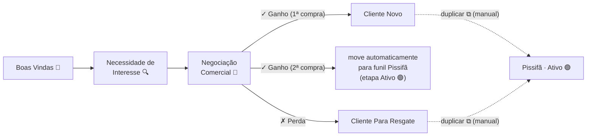
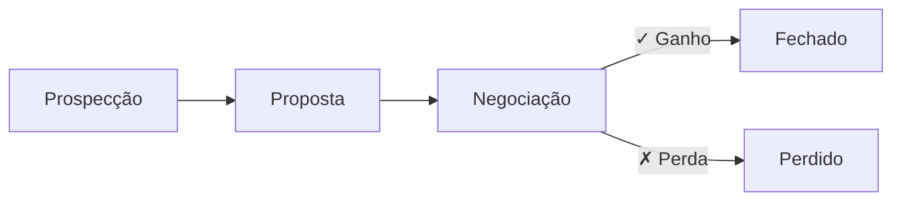
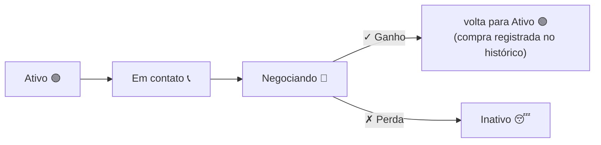
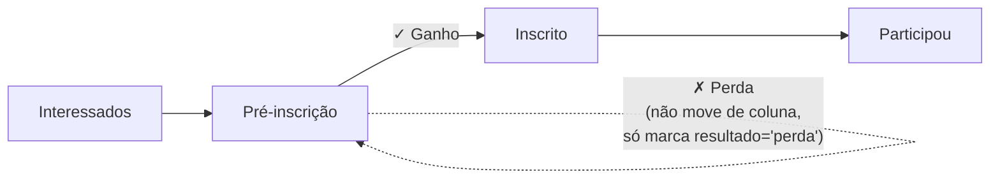

# Mapa do Fluxo dos Cards nos Funis

> Gerado a partir da lógica em [index-github.html](index-github.html) (objeto `cfg.funis`, `dropCard`, `confirmarGanho`, `confirmPerda`, `duplicarCard`, `moverParaPissifaAuto`, `reabrirCard`).

## Visão geral

O CRM tem **4 funis**, cada um com suas etapas (colunas do Kanban). Um card (`contato`) pertence a exatamente 1 funil (`c.funil`) e está em 1 etapa (`c.etapa`) por vez.

| Funil | id | Etapas |
|---|---|---|
| D2C | `d2c` | Boas Vindas 🤝 → Necessidade de Interesse 🔍 → Negociação Comercial 🤑 → **Cliente Novo** / **Cliente Para Resgate** |
| B2B | `b2b` | Prospecção → Proposta → Negociação → **Fechado** / **Perdido** |
| Pissifã | `pissifa` | Ativo 🟢 → Em contato 📞 → Negociando 🤑 → **Inativo** 😴 |
| Serviços | `servicos` | Interessados → Pré-inscrição → **Inscrito** → Participou |

Etapas em **negrito/destaque** são etapas terminais de "ganho" ou "perda" (ver regras abaixo).

---

## 1. Funil D2C

**Regras específicas do D2C:**
- Card só mostra botões **✓ Ganho / ✗ Perda** quando está na etapa "Negociação Comercial".
- **✓ Ganho** exige pelo menos 1 item no pedido + forma de pagamento. Se for a **2ª compra** do mesmo contato (`neg_hist` já tem 1 ganho anterior), o card é **movido automaticamente** (não duplicado) para o funil **Pissifã**, na 1ª etapa (`psf-ativo`) — desde que não exista já outro card do mesmo telefone no Pissifã. Caso contrário, vai para "Cliente Novo".
- **✗ Perda** move o card para "Cliente Para Resgate" e limpa o campo `resultado`.
- Em qualquer etapa (Cliente Novo, Cliente Para Resgate) o vendedor pode clicar em **⧉ Duplicar** para copiar manualmente o card para o funil Pissifã (etapa "Ativo"), caso o cliente ainda não esteja lá.
- **Reabrir card** (na tela de detalhe): remove o último resultado do histórico (`neg_hist`) e volta o card ao estado "em atendimento".

---

## 2. Funil B2B

**Regras específicas do B2B:**
- Botões Ganho/Perda aparecem apenas na etapa "Negociação".
- **✓ Ganho** → etapa "Fechado" (`b2b-fech`), pedido + forma de pagamento obrigatórios, entra no histórico `neg_hist`.
- **✗ Perda** → etapa "Perdido" (`b2b-perd`), motivo obrigatório.
- Não há movimentação automática para outro funil (isso é exclusivo do D2C).

---

## 3. Funil Pissifã (clube de recompra)

**Regras específicas do Pissifã:**
- Este é o funil de recompra: recebe cards automaticamente do D2C (2ª compra) ou manualmente via "Duplicar" a partir de D2C/Serviços.
- Botões Ganho/Perda só na etapa "Negociando".
- **✓ Ganho** → card **permanece/retorna** para "Ativo 🟢" (não avança para uma etapa "final" separada — o cliente segue ativo no clube).
- **✗ Perda** → etapa "Inativo 😴", `resultado` é zerado (a perda aqui é só um estado, não bloqueia reabertura futura).
- Um telefone só pode ter **1 card no Pissifã por vez** — tanto a duplicação manual quanto a automática verificam duplicidade por `tel` antes de criar/mover.

---

## 4. Funil Serviços (oficinas/eventos)

**Regras específicas de Serviços — este funil se comporta diferente dos outros três:**
- A etapa de "negociação" aqui é qualquer etapa cujo nome contenha **"inscrição"** ou **"inscrito"** (ex.: Pré-inscrição) — é dinâmico por nome, não por id fixo, porque as etapas podem ser renomeadas em Config.
- **✓ Ganho** → o card é movido para a etapa cujo nome contém "inscrito" e é registrada uma participação (`oficinas_hist`) com status `inscrito`.
- **✗ Perda**: **não move o card de coluna** (diferente de D2C/B2B/Pissifã) — apenas marca `resultado='perda'` e registra `oficinas_hist` com status `cancelado`. O card fica "escondido" da contagem normal da etapa e some para a coluna sintética **"Cancelados"**, visível apenas no board especial de Oficinas (aba Oficinas, não o Kanban do Funil).
- Quando um card chega à etapa cujo nome contém "participou" (arrastado manualmente), é registrada uma participação com status `participou`.
- A aba **Oficinas** mostra uma matriz Oficina × Etapas (mais coluna "Cancelados") contando os cards de Serviços agrupados por produto/oficina.

---

## Regras transversais (valem para os 4 funis)

1. **Drag & drop** (`dropCard`) dispara a mesma lógica que os botões Ganho/Perda quando o card sai de uma etapa de "negociação" para uma etapa reconhecida como ganho ou perda pelo nome da etapa de destino (contém "cliente novo", "fechado", "inscrito" etc. para ganho; "perdido", "inativo" para perda).
2. Um card que já tem um "ganho" anterior no histórico e é arrastado direto para uma etapa de ganho **não abre o modal de pedido de novo** — apenas atualiza a etapa (evita duplicar venda).
3. Todo **✓ Ganho** confirmado (`confirmarGanho`):
   - grava um registro em `neg_hist` (`{r:'ganho', d, v, itens, fp, venda_id}`);
   - dá baixa no estoque dos itens vendidos (`moverEstoquePedido`);
   - cria encomenda(s) a partir do pedido (`criarEncomendasDoGanho`);
   - registra log de auditoria (`logAction`).
4. Todo **✗ Perda** confirmada (`confirmPerda`) grava `{r:'perda', d, m: motivo}` em `neg_hist` e loga a ação.
5. **Reabrir card**: disponível na tela de detalhe para qualquer card com resultado — remove o último evento do `neg_hist` e volta o card ao estado neutro ("em atendimento"), sem trocar de etapa automaticamente.
6. Etapas, nomes e até funis inteiros são editáveis pelo usuário na aba **Config** (`saveFunil`, `saveEtapa`, `delFunil`, `delEtapa`) — por isso várias regras (D2C, Serviços) resolvem a etapa-alvo **pelo nome**, não por id fixo, para continuar funcionando mesmo que o usuário renomeie colunas.
